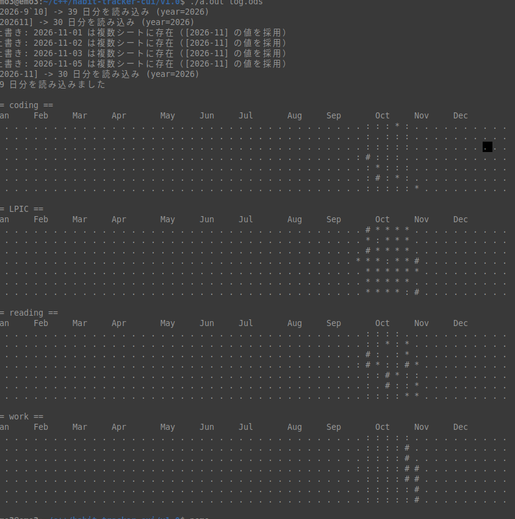

## 概要
このプログラムは、githubの草を生やすように、自分のlog.odsの情報を読み取って作業時間を可視化するプログラム。

## 動作環境
Linux

## 開発環境
linux mint 22.3

## コンパイルと実行方法
対象のフォルダに移動して、
g++ main.cpp
./a.out

## LISCENSE 
liscenceを参照

## Overview
This program reads the information from your `log.ods` file to visualize your work time, similar to how GitHub lets you “grow grass.”

## System Requirements
Linux

## Development Environment
Linux Mint 22.3

## Compilation and Execution
Navigate to the target folder, then run:
g++ main.cpp
./a.out

## LICENSE
See the license.
